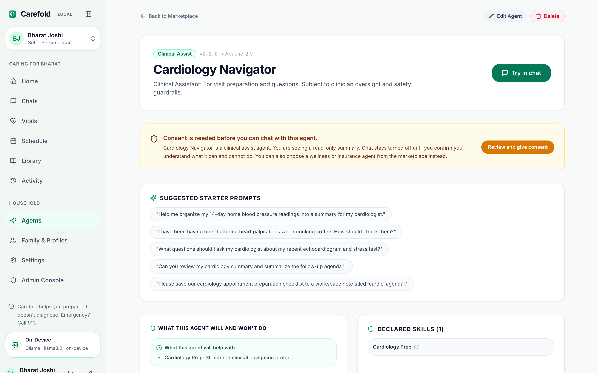
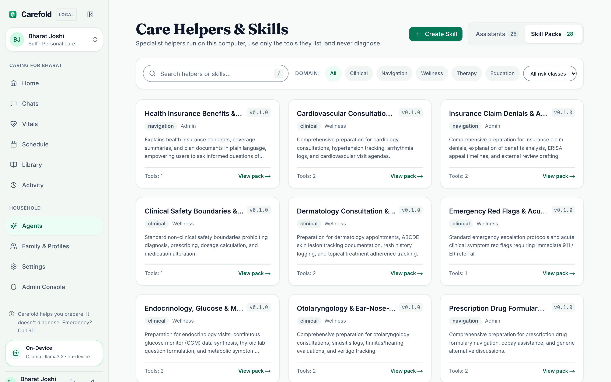

# Specialist Agent Catalog

Carefold includes a living catalog of **25 specialized healthcare agents** organized into **18 clinical organ & specialty navigators**, **5 administrative & insurance stewards**, and **2 wellness & nutrition companions**, alongside the community agent starter template (`_template`) and 6 internal system agents (`agents/_system/`).

Each agent operates within strict non-clinical boundaries, empowering patients and household caregivers with appointment preparation agendas, communication checklists, symptom and vital tracking templates, and insurance navigation guides.

!!! info "Risk Classification & Clinical Consent Gating"
    Clinical specialty navigators (including `visit-steward`) are classified `clinical_assist`. Before chatting with one, the web client asks for explicit, per-agent consent and only then sends `allow_clinical: true`; consent is stored per profile and can be withdrawn anytime. `wellness`, `admin`, and `education` agents are never gated. See [Safety Boundaries](../safety/boundaries.md#clinical-consent-gate).

---

## Organ-Specific & Clinical Specialty Navigators (18 Agents)

These agents specialize in organ systems and medical subspecialties. They help patients track symptoms, review home vitals and lab trends, prepare structured agendas for specialist appointments, and formulate collaborative questions for their physicians.

| Agent ID | Title | Domain / Category | Declared Skills | Permitted Tools | Risk Class |
|---|---|---|---|---|---|
| `cardiology-guide` | Cardiology Navigator | `clinical.cardiology` | `cardiology-prep`, `emergency-red-flags`, `clinical-safety-boundaries` | `attach-read`, `skill-docs`, `workspace-note` | `clinical_assist` |
| `derma-guide` | Dermatology Navigator | `clinical.dermatology` | `derma-prep`, `clinical-safety-boundaries` | `attach-read`, `skill-docs`, `workspace-note` | `clinical_assist` |
| `endocrinology-guide` | Endocrinology Navigator | `clinical.endocrinology` | `endocrinology-prep`, `clinical-safety-boundaries` | `attach-read`, `skill-docs`, `workspace-note` | `clinical_assist` |
| `ent-guide` | ENT Navigator | `clinical.ent` | `ent-prep`, `clinical-safety-boundaries` | `attach-read`, `skill-docs`, `workspace-note` | `clinical_assist` |
| `eye-guide` | Ophthalmology Navigator | `clinical.ophthalmology` | `vision-prep`, `clinical-safety-boundaries` | `attach-read`, `skill-docs`, `workspace-note` | `clinical_assist` |
| `gastro-guide` | Gastroenterology Navigator | `clinical.gastroenterology` | `gastro-prep`, `clinical-safety-boundaries` | `attach-read`, `skill-docs`, `workspace-note` | `clinical_assist` |
| `hematology-guide` | Hematology Navigator | `clinical.hematology` | `hematology-prep`, `emergency-red-flags`, `clinical-safety-boundaries` | `attach-read`, `skill-docs`, `workspace-note` | `clinical_assist` |
| `nephrology-guide` | Nephrology Navigator | `clinical.nephrology` | `nephrology-prep`, `clinical-safety-boundaries` | `attach-read`, `skill-docs`, `workspace-note` | `clinical_assist` |
| `neurology-guide` | Neurology Navigator | `clinical.neurology` | `neurology-prep`, `emergency-red-flags`, `clinical-safety-boundaries` | `attach-read`, `skill-docs`, `workspace-note` | `clinical_assist` |
| `oncology-navigator` | Oncology Care Steward | `clinical.oncology` | `oncology-prep`, `emergency-red-flags`, `clinical-safety-boundaries` | `attach-read`, `skill-docs`, `workspace-note` | `clinical_assist` |
| `oral-health-guide` | Oral Health & Dental Guide | `clinical.dentistry` | `oral-health-prep`, `emergency-red-flags`, `clinical-safety-boundaries` | `attach-read`, `skill-docs`, `workspace-note` | `clinical_assist` |
| `ortho-guide` | Orthopedics Navigator | `clinical.orthopedics` | `ortho-prep`, `clinical-safety-boundaries` | `attach-read`, `skill-docs`, `workspace-note` | `clinical_assist` |
| `podiatry-guide` | Podiatry & Foot Care Guide | `clinical.podiatry` | `podiatry-prep`, `emergency-red-flags`, `clinical-safety-boundaries` | `attach-read`, `skill-docs`, `workspace-note` | `clinical_assist` |
| `pulmonology-guide` | Pulmonology Navigator | `clinical.pulmonology` | `pulmonology-prep`, `emergency-red-flags`, `clinical-safety-boundaries` | `attach-read`, `skill-docs`, `workspace-note` | `clinical_assist` |
| `rheuma-guide` | Rheumatology Navigator | `clinical.rheumatology` | `rheuma-prep`, `clinical-safety-boundaries` | `attach-read`, `skill-docs`, `workspace-note` | `clinical_assist` |
| `urology-guide` | Urology Navigator | `clinical.urology` | `urology-prep`, `clinical-safety-boundaries` | `attach-read`, `skill-docs`, `workspace-note` | `clinical_assist` |
| `vascular-guide` | Vascular Medicine Guide | `clinical.vascular` | `vascular-prep`, `emergency-red-flags`, `clinical-safety-boundaries` | `attach-read`, `skill-docs`, `workspace-note` | `clinical_assist` |
| `visit-steward` | Visit Steward | `clinical.general` | `visit-prep`, `emergency-red-flags`, `clinical-safety-boundaries` | `attach-read`, `skill-docs`, `workspace-note` | `clinical_assist` |

---

## Administrative & Insurance Stewards (5 Agents)

Administrative stewards assist patients and families in navigating health insurance benefits, prior authorizations, claim denials, prescription drug formularies, and multi-provider medical records.

| Agent ID | Title | Domain / Category | Declared Skills | Permitted Tools | Risk Class |
|---|---|---|---|---|---|
| `benefits-guide` | Benefits Guide | `navigation.insurance` | `benefits-explainer`, `records-management` | `attach-read`, `skill-docs` | `admin` |
| `claims-appeals-guide` | Claims & Appeals Steward | `navigation.appeals` | `claims-appeals-prep`, `benefits-explainer` | `attach-read`, `skill-docs`, `workspace-note` | `admin` |
| `formulary-guide` | Prescription & Formulary Guide | `navigation.pharmacy` | `formulary-navigation`, `benefits-explainer` | `attach-read`, `skill-docs`, `workspace-note` | `admin` |
| `prior-auth-navigator` | Prior Authorization Navigator | `navigation.authorizations` | `prior-auth-prep`, `records-management` | `attach-read`, `skill-docs`, `workspace-note` | `admin` |
| `records-coordinator` | Medical Records Coordinator | `navigation.records` | `records-management` | `attach-read`, `skill-docs`, `workspace-note` | `admin` |

---

## Wellness & Nutrition Companions (2 Agents)

Wellness companions support sustainable daily health habits, hydration, sleep routines, and evidence-based dietary pattern planning (`DASH`, `Mediterranean`, cardiometabolic and renal nutrition prep).

| Agent ID | Title | Domain / Category | Declared Skills | Permitted Tools | Risk Class |
|---|---|---|---|---|---|
| `habit-companion` | Habit Companion | `wellness.habits` | `habit-checkin` | `workspace-note` | `wellness` |
| `nutrition-dietitian-guide` | Nutrition & Dietitian Guide | `wellness.nutrition` | `nutrition-prep`, `emergency-red-flags`, `clinical-safety-boundaries` | `attach-read`, `skill-docs`, `workspace-note` | `wellness` |

---

## Modular Clinical & Administrative Skill Packs (28 Skills)

All 28 modular skill packs can be browsed in the **Skills Catalog** (`/skills` or `/helpers?tab=skills`), showing intended-use rules, permitted sandbox tools, bundled clinical reference templates, and non-clinical safety guardrails.

---

## Community Starter Template (1 Agent)

Carefold provides a starter template for community contributors authoring new agents:

| Agent ID | Title | Category | Declared Skills | Permitted Tools | Risk Class |
|---|---|---|---|---|---|
| `_template` | Template Agent | `clinical.template` | `_template` | *(None)* | `education` |

---

## Internal System Agents (`agents/_system/`)

Carefold maintains six internal agents that execute core pipeline tasks:

| Agent ID | Role & Responsibility |
|---|---|
| `orchestrator` | Coordinates two-hop intent classification, execution topology planning, and specialist dispatch. |
| `document-extractor` | Securely ingests user attachments, redacts PII, and extracts structured dossiers. |
| `quality-reviewer` | Evaluates synthesized responses for clinical safety compliance and tone neutrality. |
| `skill-generator` | Dynamically synthesizes in-memory skills or reference documents when undeclared protocols are needed. |
| `suggestion-generator` | Generates 2–3 contextual follow-up question chips based on consultation turns. |
| `triage-auditor` | Fallback routing auditor, risk tagging, and structured zero-body audit event writer. |
