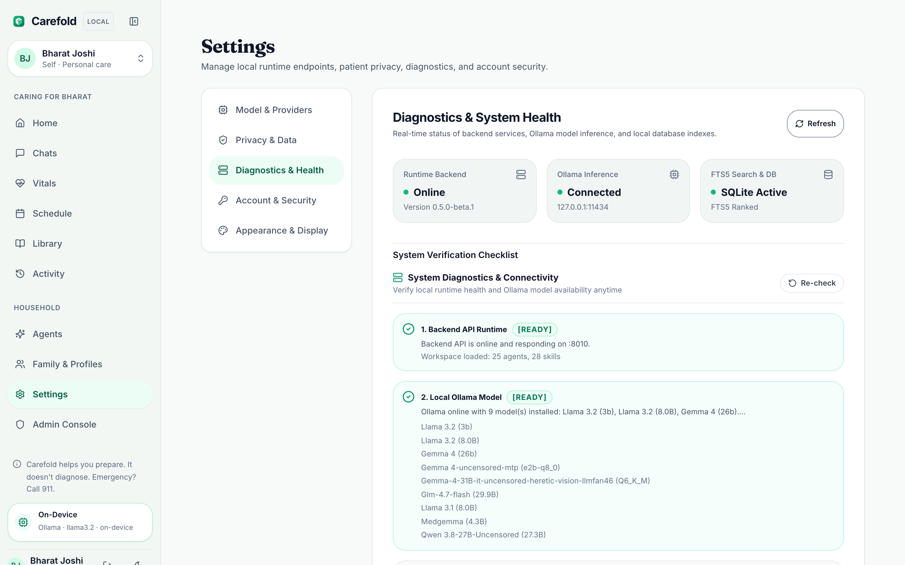

# Installation Guide

This guide walks you through setting up the Carefold monorepo for local development and household execution.

---

## Prerequisites

Before installing Carefold, ensure your system meets the following requirements:

| Component | Minimum Version | Recommended | Notes |
|---|---|---|---|
| **Python** | 3.12+ | 3.12 or 3.14 | Required for the FastAPI backend (`carefold` + `yarvelle-core`) and LangGraph engine. |
| **Node.js** | 22.0.0+ | 22.x LTS | Required for Next.js 16 (`frontend/`) and workspace packages (`engines.node >=22.0.0`). |
| **pnpm** | 9.0.0+ | 10.x or 12.x | Fast, disk-space efficient workspace package manager. |
| **Ollama** | Latest | 0.3.0+ | Recommended for local-first zero-telemetry LLM inference. |
| **Docker** | 24.0+ | Latest | Optional; required if running container images or `deploy/docker/docker-compose.yml`. |

---

## Fast Path: Run via Prebuilt Docker Container

If you want to run Carefold without configuring local Python and Node.js environments, launch the official multi-architecture container:

```bash
# Pull multi-arch image (Apple Silicon arm64 & Intel/AMD amd64)
docker pull ghcr.io/spectrayan/carefold:latest

# Start all-in-one container (:3000 web UI, :8000 backend API)
docker run -d \
  --name carefold \
  -p 127.0.0.1:3000:3000 \
  -p 127.0.0.1:8000:8000 \
  -e OLLAMA_URL=http://host.docker.internal:11434/v1 \
  -v carefold-data:/data \
  ghcr.io/spectrayan/carefold:latest
```

Access the UI at `http://localhost:3000`.

> [!NOTE]
> - **Connecting to Ollama on host**: On Docker Desktop (macOS / Windows), pass `-e OLLAMA_URL=http://host.docker.internal:11434/v1` so the container routes to Ollama running on your workstation.
> - **Multi-Architecture**: Carefold publishes multi-architecture manifests supporting both `linux/amd64` and `linux/arm64`. Docker automatically selects your native architecture.

---

## Step 1: Clone the Repository

Clone the Carefold repository from GitHub and navigate to the project directory:

```bash
git clone https://github.com/spectrayan/carefold.git
cd carefold
```

---

## Step 2: Set Up Backend Environment

Carefold uses a Python virtual environment in `backend/.venv` to isolate backend dependencies (including `yarvelle-core>=0.1.1`).

### 1. Create and Activate Virtual Environment

```bash
# Create virtual environment inside backend directory
python3 -m venv backend/.venv

# Activate on macOS / Linux
source backend/.venv/bin/activate

# Or activate on Windows (PowerShell)
# .\backend\.venv\Scripts\Activate.ps1
```

### 2. Install Backend Package

Install the `carefold` package in editable mode along with runtime and development dependencies:

```bash
pip install -e "backend[dev]"
pip install -r backend/requirements-dev.txt
```

---

## Step 3: Install Web Frontend & Workspace Dependencies

Carefold uses `pnpm` workspaces for web and CLI package management.

```bash
pnpm install
```

This installs dependencies across:
- `frontend/`: Next.js 16 consultation and household care application (`@spectrayan/carefold-web`, consuming `@yarvelle/ui` and `@spectrayan/carefold`).
- `tools/cli/`: Scaffolding, evaluation, and diagnostics CLI (`@spectrayan/carefold-cli`).
- `tools/runner/`: Standalone sandboxed agent execution runner (`@spectrayan/carefold-runner`).

---

## Step 4: Install and Configure Ollama (Local Inference)

Carefold is configured by default to connect to a local Ollama server endpoint at `http://127.0.0.1:11434/v1`.

1. **Install Ollama**: Download and install from [ollama.ai](https://ollama.ai).
2. **Start the Ollama daemon**:
   ```bash
   ollama serve
   ```
3. **Pull the default model**:
   ```bash
   ollama pull llama3.2
   ```

*(Optional)* You can also pull alternative supported models such as `mistral`, `llama3.1`, or `deepseek-r1`.

---

## Step 5: Verify Installation & Runtime Diagnostics

You can verify your installation from the terminal or directly in the Web UI under **Settings → Diagnostics** (`/settings/diagnostics`):



### 1. Backend Verification
```bash
# Run backend test suite
PYTHONPATH=backend/src backend/.venv/bin/pytest backend/tests/

# Run 47-point security penetration suite
PYTHONPATH=backend/src backend/.venv/bin/python backend/tests/penetration_suite.py
```

### 2. Frontend Verification
```bash
# Validate TypeScript typings
pnpm --filter @spectrayan/carefold-web typecheck

# Run web unit and component tests
pnpm --filter @spectrayan/carefold-web test --exclude "**/api/**"
```

### 3. License Header Verification
```bash
# Verify official Spectrayan PolyForm Noncommercial + Additional Terms headers
pnpm run check:licenses
```

Once all verification commands pass, proceed to the [Configuration Guide](configuration.md) or jump straight to the [Quickstart Guide](quickstart.md).
