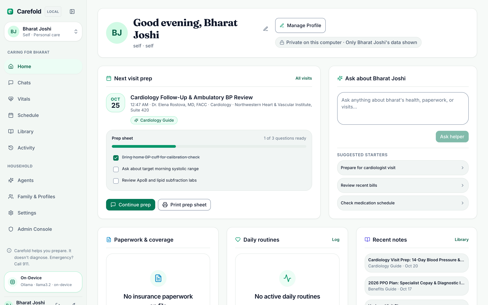
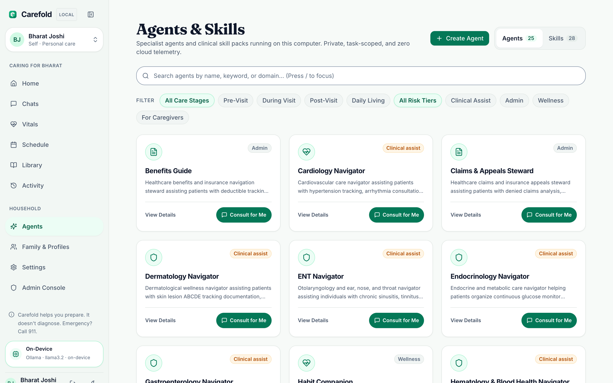
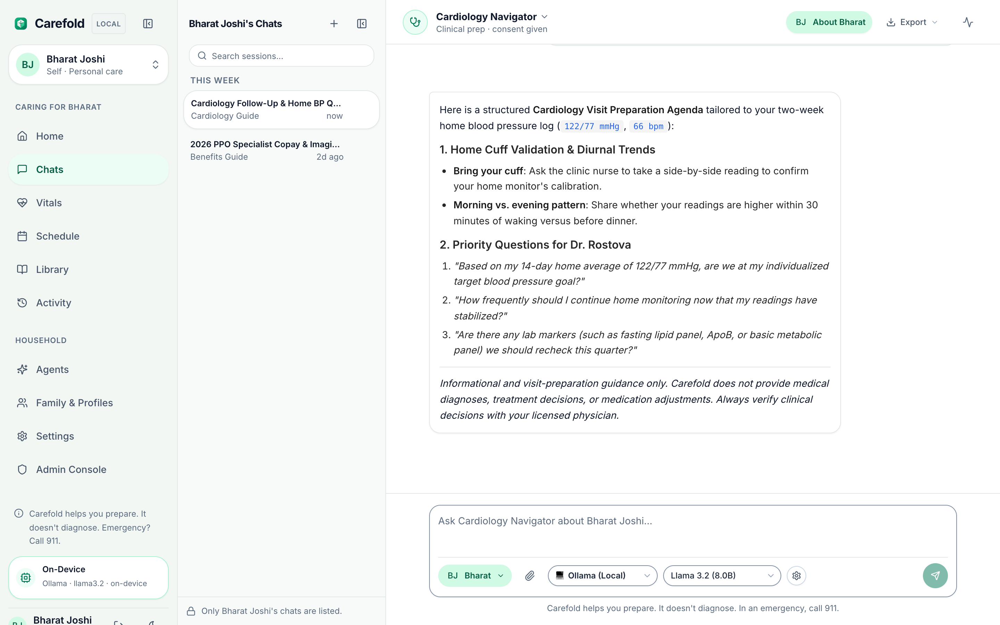
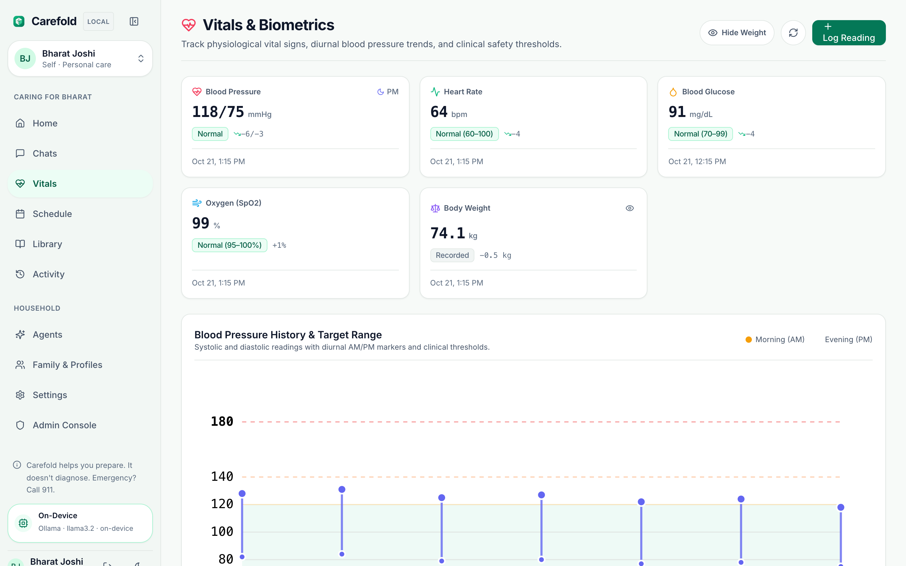
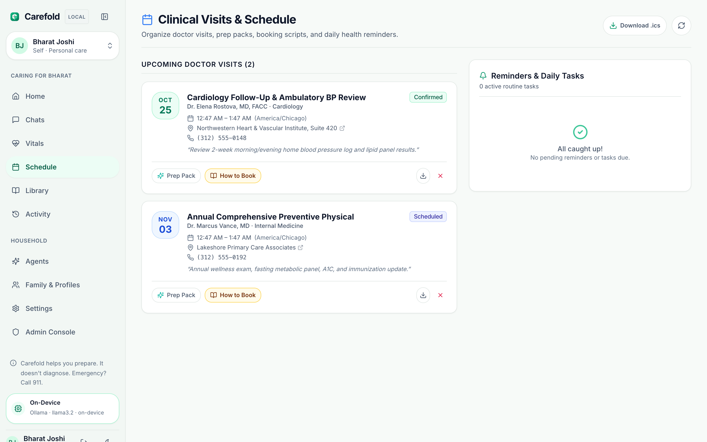
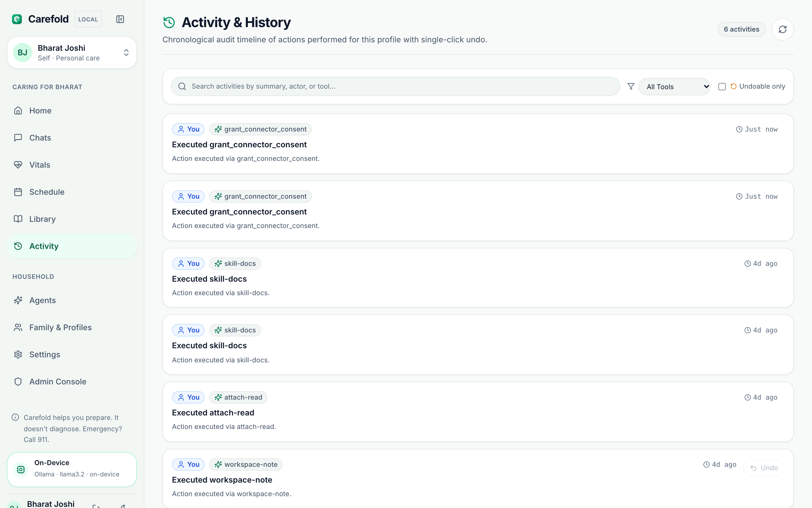

# Quickstart Guide

This tutorial guides you through starting the Carefold services and exploring your household health companion in under five minutes.

---

## Architecture Overview of Local Services

Running Carefold locally spins up two coordinated processes:
1. **FastAPI Backend (`backend/`)**: Serves REST APIs, health pack routes, and Server-Sent Events (SSE) streaming on `http://127.0.0.1:8010`.
2. **Next.js Web UI (`frontend/`)**: Provides the household care dashboard, specialist marketplace, vitals tracker, and consultation studio on `http://localhost:3010`.

---

## Step 1: Launch Carefold with `./start.sh`

From the repository root, start both the FastAPI backend (`:8010`) and Next.js frontend (`:3010`) using the unified coordinator script:

```bash
# Start both services in the foreground (or use `./start.sh start` for background daemon mode)
./start.sh
```

You can inspect service health anytime using `./start.sh status` or by querying the backend health endpoint:

```bash
curl http://127.0.0.1:8010/api/v1/health
```

Expected JSON response (abbreviated):
```json
{
  "status": "ok",
  "version": "0.5.0b2",
  "modelReachable": true,
  "workspace": {
    "root": "/path/to/carefold",
    "agentsCount": 25,
    "skillsCount": 28
  }
}
```

---

## Step 2: Explore Your Household Care Dashboard

Open your browser to `http://localhost:3010`. After signing in (or creating your local household steward account), you land on the **Household Care Dashboard**:



From the dashboard you can:
- Review your **Next Visit Prep** checklist and progress bar for upcoming clinical appointments.
- Launch a quick consultation using the **Ask about [Person]** composer and starter prompts.
- Inspect **Recent Notes**, **Daily Routines**, and **Paperwork & Coverage** summaries.
- Switch between family member profiles (`Self`, `Spouse`, `Child`, `Parent`) in the top-left profile switcher.

---

## Step 3: Browse the Specialist Agent Marketplace

Navigate to **Agents** (`/agents`) in the left navigation rail to explore all **25 specialist agents** across Clinical, Navigation, and Wellness domains:



Click on **Cardiology Navigator** (`cardiology-guide`) to review its clinical capabilities, declared skills (`cardiology-prep`), permitted tools, and plain-language non-clinical safety boundaries.

---

## Step 4: Start a Specialist Consultation

Click **Chats** (`/p/<profileId>/chat?agent=cardiology-guide`) to open the **Consultation Studio**:



### Example Prompt:
> *"I've been tracking my morning blood pressure with my home cuff over the last two weeks (averaging 122/77 mmHg, heart rate 66 bpm). I have a follow-up with my cardiologist on Friday. What questions should I bring to make the most of our visit?"*

### What Happens Behind the Scenes:
1. **Context Load & Memory Recall**: Recalls relevant profile memories and attached records.
2. **Input Guardrail & Red-Flag Gate**: Screens the message against multilingual emergency red-flag patterns.
3. **Two-Hop Orchestration & Skill Provisioning**: Routes to `cardiology-guide` and provisions `cardiology-prep` reference guidelines.
4. **Specialist Execution & Synthesis**: Streams a structured visit preparation agenda via SSE and attaches the canonical non-clinical disclaimer and follow-up suggestion chips.

---

## Step 5: Track Vitals, Visits & Preventive Care

Carefold includes dedicated clinical tracking workspaces for every household profile:

- **Vitals & Biometrics (`/p/<profileId>/vitals`)**: Record blood pressure, heart rate, blood glucose, SpO2, and weight/BMI with diurnal AM/PM trend analysis and real-time red-flag safety checks.
  
- **Schedule & Visit Prep (`/p/<profileId>/appointments`)**: Track upcoming appointments and generate pre-visit preparation packs.
  

---

## Step 6: Inspect the Activity & Safety Audit Log

Every tool call, consent grant, and safety guardrail check is recorded in a tamper-evident SHA-256 hash-chained audit log accessible under **Activity** (`/p/<profileId>/activity`):



Next, explore the [Architecture Overview](../architecture/overview.md) to learn how Carefold orchestrates multi-agent consultations.
