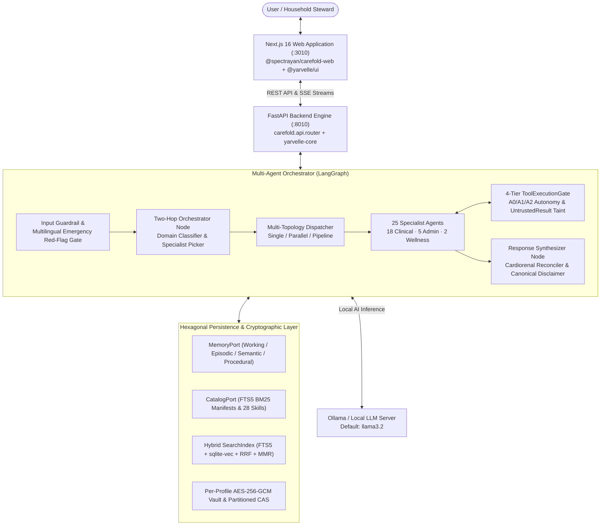
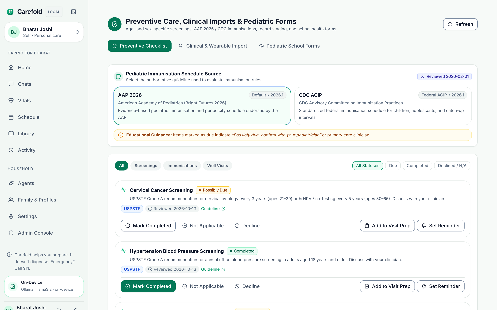
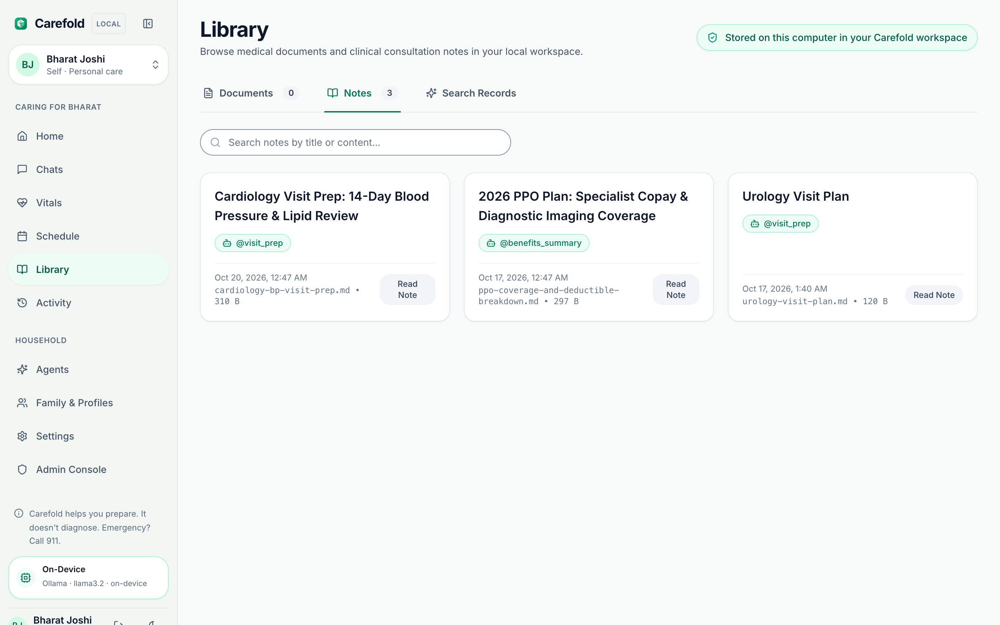
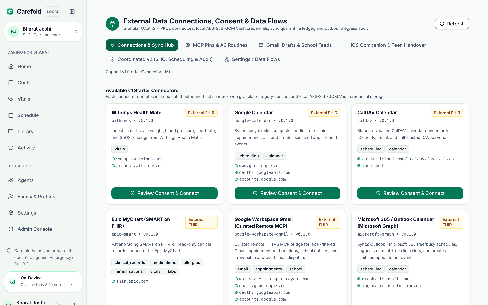
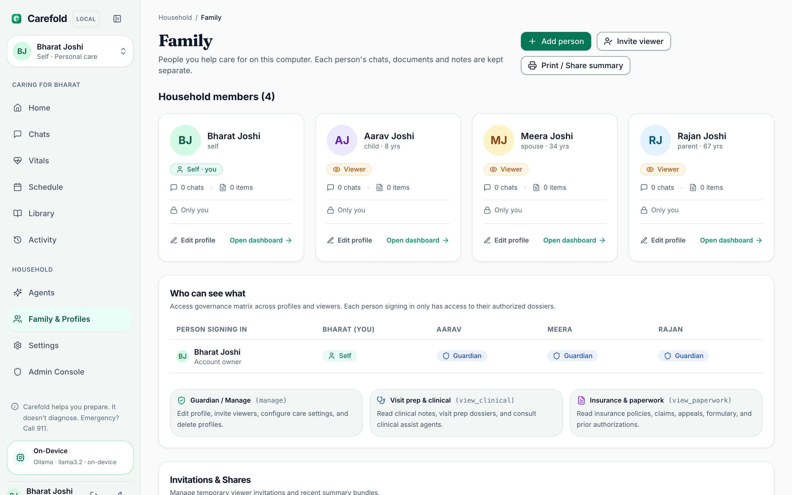

# Carefold Documentation

Welcome to the documentation for **Carefold**, a source-available, local-first personal and family health AI companion and specialist agent runtime developed by **Spectrayan** on top of [`yarvelle-core`](https://github.com/yarvelle/yarvelle-core) and `@yarvelle/ui`.

Carefold delivers empathetic, organ-specific clinical navigation, household health record stewardship, physiological vitals tracking, preventive care reminders, and health insurance navigation while enforcing strict, auditable non-clinical safety boundaries. It is designed from the ground up for patient privacy, local-first execution, and modular extensibility.

---

## High-Level System Architecture

Carefold employs a decoupled, multi-tiered architecture built on the `yarvelle-core` runtime and `@yarvelle/ui` shell, separating the Next.js 16 web experience (`frontend/`) from the FastAPI + LangGraph multi-agent execution engine (`backend/`) and hexagonal persistence layers.

---

## Visual Tour of the Carefold Workspace

Carefold provides a comprehensive household health interface running locally on your machine:

=== "Consultation Studio"
    Stream real-time consultations with any of the **25 specialist navigators**, complete with per-agent clinical consent, session history, attachment grounding, and Markdown/JSON dossier export.
    

=== "Specialist Marketplace"
    Browse and filter **25 specialist agents** across Clinical, Navigation, and Wellness domains, care stages (`Before visit`, `During visit`, `After visit`, `Follow-up`, `Daily living`), and caregiver support.
    

=== "Vitals & Biometrics"
    Log and visualize HL7 FHIR R4 / LOINC-coded vital signs (blood pressure with diurnal AM/PM trends, heart rate, blood glucose, SpO2, and body weight/BMI with CDC pediatric LMS percentiles) alongside real-time clinical red-flag screening.
    

=== "Clinical Visits & Schedule"
    Manage upcoming clinical appointments, generate pre-visit preparation packs and phone scripts, and track post-visit follow-ups.
    

=== "Preventive Care & School Forms"
    Track age- and sex-appropriate USPSTF/ACIP preventive care checklists and generate pediatric school, camp, and sports health forms.
    

=== "Library & Visit Notes"
    Inspect sanitized medical record attachments and structured clinical visit preparation notes stored locally in your Carefold workspace.
    

=== "Scoped Connections"
    Connect external health portals, wearables, and calendars (`Withings`, `Epic SMART on FHIR`, `Google Calendar`, `CalDAV`, `Google Workspace Gmail MCP`, `Microsoft 365 Graph`) with granular category consent, local AES-256-GCM Vault credential storage, and outbound host allowlisting.
    

=== "Household Profiles & Audit"
    Manage separate, cryptographically isolated profiles for every family member (`Self`, `Spouse`, `Child`, `Parent`) and inspect the tamper-evident SHA-256 hash-chained activity log.
    

---

## Core Pillars

Carefold is built on five core design principles:

### 1. Local-First Privacy & Household Sovereignty
Health data belongs under patient and family custody. Carefold operates on-device by default, utilizing [Ollama](https://ollama.ai) for local inference, SQLite FTS5 + `sqlite-vec` for local hybrid retrieval, and per-profile `HKDF-SHA256` / `AES-256-GCM` envelope encryption (`ADR-0005`, `ADR-0007`). No conversation text, attachments, or clinical dossiers leave your workstation unless an external provider or scoped connector is explicitly authorized.

### 2. Pure Persona Purity
Specialist agent personas (`persona.md`) are decoupled from filesystem paths and tool-calling plumbing. Specialists focus on empathetic communication, clinical interview methodology, and red-flag awareness, while the central **Orchestrator** dynamically provisions relevant clinical guidelines, checklists, and reference forms into the agent's context (`ADR-0001`, `ADR-0003`).

### 3. Hexagonal Cognitive Memory
Carefold models memory across four cognitive tiers (`ADR-0002`):
- **`WORKING`**: Ephemeral turn scratchpad and active execution state.
- **`EPISODIC`**: Timestamped chronological interaction history.
- **`SEMANTIC`**: Consolidated patient profile, preferences, and longitudinal facts.
- **`PROCEDURAL`**: Clinical guidelines, checklists, and standard operating procedures.

### 4. Deterministic Clinical Safety & 4-Tier Policy Gate
Carefold enforces multi-layered safety gates prior to and during agent execution:
- **Multilingual Emergency Red-Flag Detection**: Pre-emptively catches acute life-threatening presentations across `en-US`, `es-ES`, `fr-FR`, `hi-IN`, and `ar-SA` and immediately directs to `911` / `988` / `112` emergency services (`ADR-0009`).
- **Strict Non-Clinical Boundaries**: Refuses requests to provide formal medical diagnoses, calculate or adjust medication dosages, or replace acute clinical triage.
- **4-Tier Policy Gate (`ADR-0004`)**: Enforces `read`, `write_local`, `write_external`, and `irreversible` tool risk classes across `A0`/`A1`/`A2` autonomy levels with `UntrustedResult` taint tracking and SHA-256 hash-chained `audit_events`.

### 5. Specialized Multi-Agent Ecosystem
The marketplace provides **25 specialist agents** spanning **18 clinical navigators**, **5 administrative & insurance stewards**, and **2 wellness & nutrition companions**, backed by **28 modular skill packs**, 6 internal system agents (`agents/_system/`), and `_template` starters.

---

## Documentation Roadmap

| Section | Description |
|---|---|
| [**Getting Started**](getting-started/installation.md) | Installation instructions, environment configuration, Ollama setup, and 5-minute quickstart guide. |
| [**Architecture**](architecture/overview.md) | System overview, the 5-phase orchestrator lifecycle, execution topologies, and two-hop routing. |
| [**Specialist Agents**](agents/catalog.md) | Catalog of all 25 specialist agents, manifest specifications, and persona contracts. |
| [**Skills**](skills/authoring.md) | Guide to authoring skills, intended-use statements, and reference document integration. |
| [**Connectors**](connectors/authoring.md) | Scoped Connector SDK authoring guide, `ScopedHttp` egress allowlisting, and `UntrustedResult` taint propagation. |
| [**Cognitive Memory**](memory/spector.md) | Hexagonal architecture, the 4 cognitive memory tiers, and SQLite FTS5 / Spector MCP adapters. |
| [**Safety & Guardrails**](safety/boundaries.md) | Clinical risk classes, refusal rules, emergency red flags, and tamper-evident audit logging. |
| [**Compliance & Security**](compliance/google-verification-and-casa.md) | OAuth CASA Tier 2/3, OWASP ASVS L2, threat model, HIPAA Safe Harbor, MHMDA, DPDP, and FTC HBNR readiness packs. |
| [**API Reference**](api/reference.md) | Complete REST API endpoints and Server-Sent Events (SSE) streaming protocol. |
| [**Architecture Decision Records**](adr/README.md) | Living ADR framework (`0001`–`0009`) capturing formal architectural decisions. |
